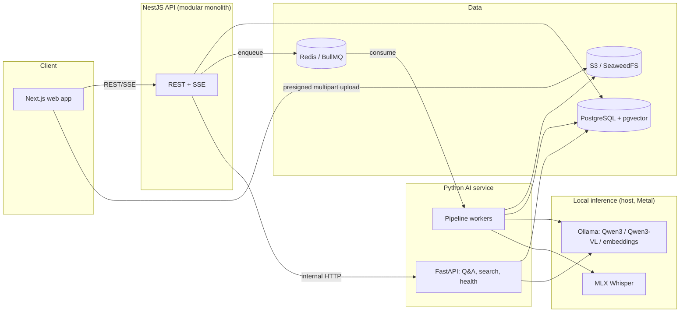

# Video Intelligence Platform

> Turn hours of video into actionable knowledge.

An AI-powered platform that turns long-form video (podcasts, lectures, conference talks, webinars, tutorials) into a structured, interactive **intelligence report**. The report has an executive summary, key takeaways, chapters, highlights and topics, and a timestamp-grounded "Ask AI" chat.

The project is also a deliberate engineering exercise. It is meant to show **strong backend engineering** (a modular monolith, asynchronous event-driven processing, idempotent jobs, clean module boundaries) and **practical AI engineering** (hierarchical summarization, structured outputs, grounded RAG, evaluation, and running local inference on modest hardware).

---

## Status

| Phase | Scope                                                                             | Status                 |
| ----- | --------------------------------------------------------------------------------- | ---------------------- |
| 0     | Architecture & documentation                                                      | ✅ Approved 2026-11-21 |
| 1     | Foundation (repo, Docker Compose, NestJS, FastAPI, health checks, spikes)         | ✅ Done                |
| 2–7   | Ingestion → Transcription → AI Intelligence → Frontend → Advanced AI → Production | ⏳ Not started         |

Phase 1 delivered the running skeleton: infrastructure, API and AI service health checks, CI, and two spikes that validated the cross-language queue and local inference ([docs/BENCHMARKS.md](docs/BENCHMARKS.md)). Product features start in Phase 2. See [docs/ROADMAP.md](docs/ROADMAP.md).

---

## What a user gets

For every processed video:

- **Executive summary**: the central message, main arguments and conclusions.
- **Key takeaways**: 5–15 insights, each with a title, a description, why it matters, and a timestamp.
- **Intelligent chapters**: a title, description, and start/end time for each.
- **Highlights**: explanations, surprising insights, recommendations, demos, and Q&A moments, each timestamped.
- **Topics & concepts**: browsable subjects with the timestamps where they are discussed.
- **Ask AI**: answers grounded in the transcript, with timestamp citations, that separate _stated in the video_ from _AI interpretation_.

---

## Architecture at a glance



- **NestJS** owns the product domain: auth, users, videos, uploads, job creation and orchestration, and the read APIs.
- **Python** owns media processing and AI: FFmpeg, PySceneDetect, Whisper, LangGraph pipelines, embeddings, and Q&A.
- **Redis + BullMQ** carry the asynchronous pipeline. **PostgreSQL + pgvector** store everything relational, plus the vectors for semantic search.
- On a Mac, **AI inference runs natively on the host** (Docker cannot use Apple's Metal GPU). Everything else runs in Docker Compose.

Full details: [docs/ARCHITECTURE.md](docs/ARCHITECTURE.md).

---

## Tech stack

| Layer      | Technology                                                         |
| ---------- | ------------------------------------------------------------------ |
| Frontend   | Next.js (App Router), React, TypeScript (strict)                   |
| API        | NestJS, Node.js, TypeScript (strict), Drizzle ORM                  |
| AI service | Python 3.12, FastAPI, LangGraph, Pydantic v2, SQLAlchemy Core      |
| Speech     | `mlx-whisper` (local, Apple Silicon); `faster-whisper` (cloud/CI)  |
| LLMs       | Qwen3 (text), Qwen3-VL (vision), Qwen3-Embedding, served by Ollama |
| Media      | FFmpeg / ffprobe, PySceneDetect                                    |
| Data       | PostgreSQL 16 + pgvector, Redis 7, S3 (SeaweedFS locally)          |
| Queue      | BullMQ (Node producer, Python consumer)                            |
| Ops        | Docker, GitHub Actions, OpenTelemetry, Grafana, AWS ECS            |

The reasoning behind each choice: [docs/TECHNICAL_DECISIONS.md](docs/TECHNICAL_DECISIONS.md).

---

## Planned repository layout

```
video-intelligence-platform/
├── apps/
│   ├── web/                 # Next.js frontend
│   └── api/                 # NestJS modular monolith
├── services/
│   └── ai/                  # Python: FastAPI app + pipeline workers (one package, two entrypoints)
├── packages/
│   └── contracts/           # JSON Schemas for queue payloads/events → generated TS + Pydantic types
├── infra/
│   ├── compose/             # docker-compose.yml + profiles
│   └── aws/                 # IaC (Phase 7)
├── evals/                   # Golden datasets + evaluation harness
├── docs/
└── .github/workflows/
```

---

## Local development

Full guide, ports and troubleshooting: [docs/LOCAL_DEVELOPMENT.md](docs/LOCAL_DEVELOPMENT.md).

**Prerequisites** (Apple Silicon Mac, 16 GB+ RAM): Docker Desktop, Node.js 24+ with pnpm 10, [uv](https://docs.astral.sh/uv/), FFmpeg, and [Ollama](https://ollama.com) installed natively (not in Docker).

```bash
make setup       # pnpm install + uv sync, creates .env from .env.example
```

```bash
make models      # pulls the Qwen3 models into Ollama (~11.6 GB)
```

```bash
make up          # Postgres, Redis, SeaweedFS (S3), migrations, NestJS API (Docker)
```

```bash
make ai          # Python ai-api + ai-worker, native on the host (Metal access)
```

```bash
make web         # Next.js placeholder on http://localhost:4000
```

```bash
make check       # lint + typecheck + unit tests (what CI runs)
```

---

## Documentation

| Doc                                                   | Purpose                                                                        |
| ----------------------------------------------------- | ------------------------------------------------------------------------------ |
| [ARCHITECTURE.md](docs/ARCHITECTURE.md)               | System design, service responsibilities, pipeline, AI design, failure handling |
| [TECHNICAL_DECISIONS.md](docs/TECHNICAL_DECISIONS.md) | Architecture Decision Records (ADRs) with trade-offs                           |
| [DATABASE_SCHEMA.md](docs/DATABASE_SCHEMA.md)         | Initial schema, indexes, ownership rules                                       |
| [ROADMAP.md](docs/ROADMAP.md)                         | Phased plan with exit criteria and risks                                       |

---

## Engineering principles

1. Strict typing everywhere: TypeScript `strict`, Python type hints checked by `mypy --strict` on core packages.
2. No large payloads through synchronous API requests. Media bytes go straight to object storage.
3. Every pipeline stage is idempotent, retryable and observable.
4. Deterministic processing first. LLMs only where they add real value.
5. Every AI claim traces back to transcript segments, and so to timestamps.
6. Tests ship with features. No performance claims without measurements (measured numbers go in `docs/BENCHMARKS.md`).
7. Secrets come only from the environment. Nothing is hardcoded.
