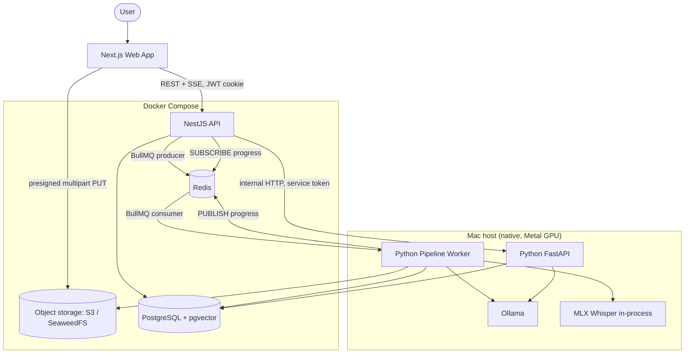
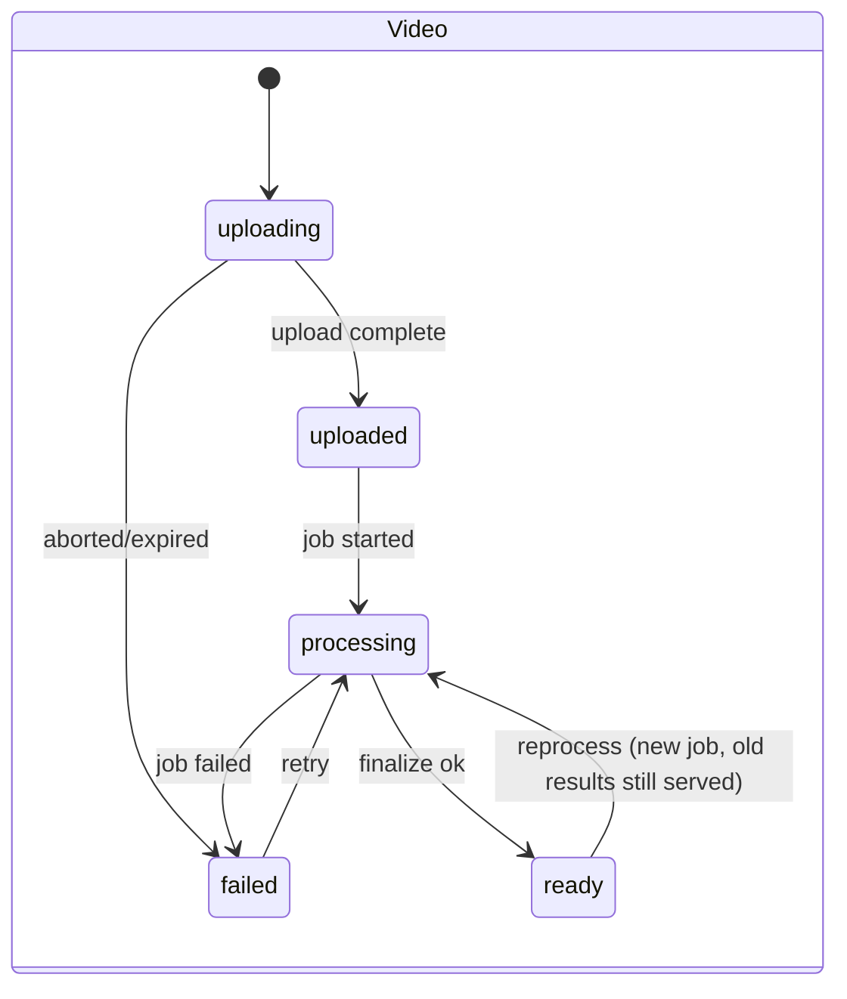
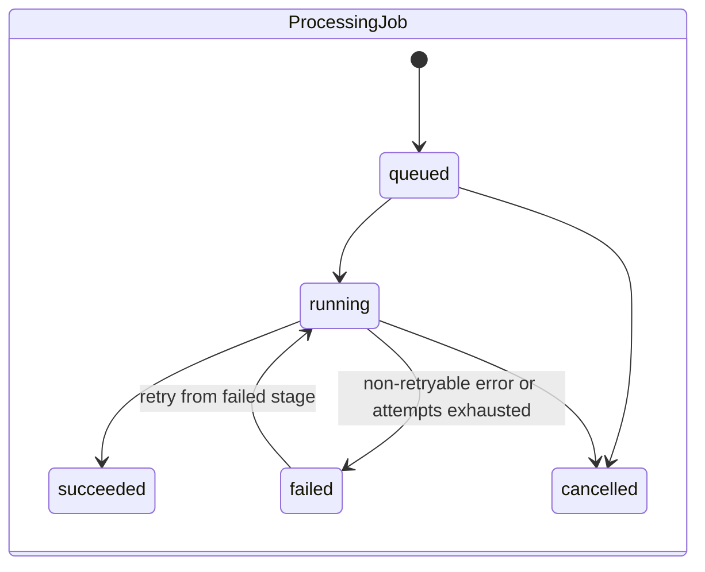
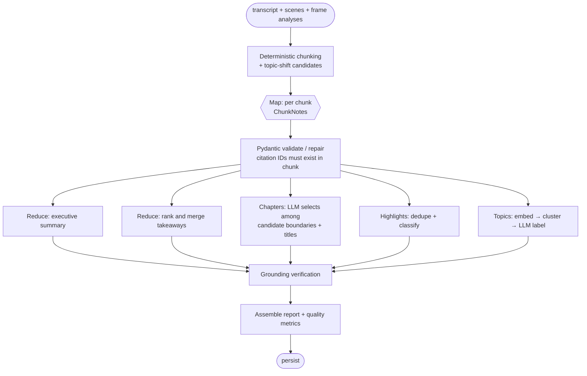
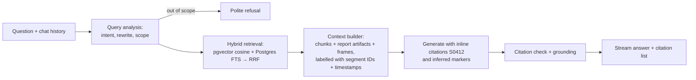
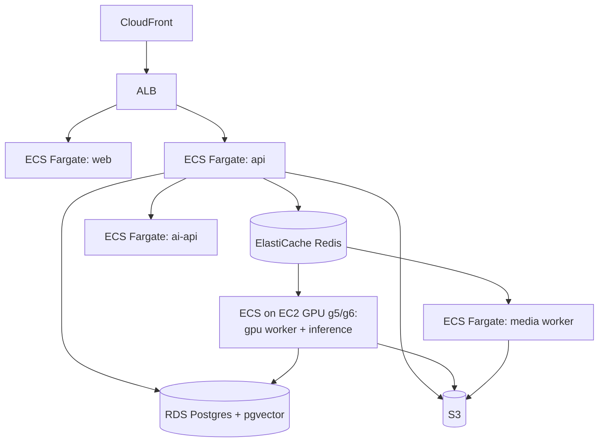

# Architecture

Status: **Proposed** (Phase 0). Last updated: 2026-11-21.

This document describes the target architecture of the Video Intelligence Platform: what each part does, how data flows, how the AI pipeline works, and how the system behaves when things fail. Decisions are summarized here and justified in [TECHNICAL_DECISIONS.md](TECHNICAL_DECISIONS.md) (referenced as `ADR-NNN`).

---

## 1. Goals and non-goals

### Goals

- Process 60–120+ minute videos into a structured, timestamp-grounded intelligence report.
- Run the full MVP **locally on an M-series Mac with 16 GB**, with no paid AI APIs.
- Asynchronous, event-driven processing that is retryable, idempotent and observable.
- A modular monolith whose modules can later be split out into services without being rewritten.
- AI output you can verify: every claim maps to transcript segments.

### Non-goals (for the MVP)

- Real-time or live-stream processing.
- Speaker diarization (planned for later; see the roadmap).
- Multi-tenant organizations or teams (single-user accounts only at first).
- Mobile apps.
- Downloading arbitrary YouTube videos (see [ADR-012](TECHNICAL_DECISIONS.md#adr-012-youtube-ingestion-only-through-authorized-methods)).

---

## 2. System context



**Why the AI side runs on the host in local development:** Docker on macOS runs containers inside a Linux VM that has no access to the Apple GPU (Metal). MLX and Ollama's Metal backend only work natively. Running them in Docker would force CPU inference, which is several times slower. In the cloud the same Python code runs in a container with CUDA backends. See [ADR-004](TECHNICAL_DECISIONS.md#adr-004-native-host-ai-inference-locally-containerized-everything-else).

---

## 3. Services and responsibilities

### 3.1 Next.js web app (`apps/web`)

- Upload UI with chunked multipart upload straight to S3 (SeaweedFS locally), plus resume and progress.
- Video library, processing status (SSE with a polling fallback), and the intelligence dashboard.
- Video player synced to timestamps (chapters, takeaways, citations jump to `currentTime`).
- Ask-AI chat with streamed answers and clickable timestamp citations.
- **No business logic or direct database access.** It talks only to the NestJS API (BFF-style use of server components is fine, but authorization stays in NestJS).

### 3.2 NestJS API (`apps/api`): modular monolith

Owns the **product domain** and is the only public backend entry point.

| Module             | Responsibility                                                                                                                                             |
| ------------------ | ---------------------------------------------------------------------------------------------------------------------------------------------------------- |
| `auth`             | Registration and login, Argon2id hashing, JWT access tokens plus rotating refresh tokens (httpOnly cookies), guards                                        |
| `users`            | Profile, ownership checks                                                                                                                                  |
| `videos`           | Video aggregate: create, list, get, soft delete, status transitions                                                                                        |
| `uploads`          | S3 multipart session lifecycle: initiate, sign part URLs, complete, abort                                                                                  |
| `ingestion`        | Source adapters: direct upload now, authorized YouTube later ([ADR-012](TECHNICAL_DECISIONS.md#adr-012-youtube-ingestion-only-through-authorized-methods)) |
| `processing`       | Creates processing jobs (idempotent), enqueues the first stage, runs the **reconciler** (finds stuck work), cancellation, retry-from-stage                 |
| `intelligence`     | Read APIs for reports, transcript, chapters, highlights, topics, search                                                                                    |
| `qa`               | Conversations and messages. Proxies questions to the Python Q&A endpoint and streams the answer back over SSE                                              |
| `events`           | SSE endpoint. Subscribes to Redis pub/sub for job progress                                                                                                 |
| `health`           | `/health/live`, `/health/ready` (DB, Redis, S3, AI service)                                                                                                |
| `common` / `infra` | Config (validated env), logging (pino), OpenTelemetry, rate limiting (throttler + Redis), error mapping, DB client                                         |

**Internal layering, applied with judgment:**

- Modules with real rules (`videos`, `processing`) get a small **domain layer**: entities and state machines as plain TypeScript with no framework imports, unit tested in isolation. On top of that sit an **application layer** (use cases or services) and **infrastructure adapters** (Drizzle repositories, the BullMQ producer, the S3 client) injected through Nest DI behind interfaces.
- Thin CRUD-style modules (`users`, `health`) use plain Nest services. No ceremony where it adds nothing ([ADR-002](TECHNICAL_DECISIONS.md#adr-002-modular-monolith-with-selective-clean-architecture)).
- Modules talk only through exported services or interfaces, never by reaching into each other's tables. An ESLint boundaries rule enforces this.

### 3.3 Python AI service (`services/ai`)

One Python package with **two entrypoints**, sharing domain code:

| Entrypoint         | Purpose                                                                                                               |
| ------------------ | --------------------------------------------------------------------------------------------------------------------- |
| `ai-worker`        | BullMQ consumer that runs the pipeline stages (media, transcription, vision, analysis, embedding)                     |
| `ai-api` (FastAPI) | Low-latency synchronous endpoints: `/internal/v1/qa` (streaming), `/internal/v1/search`, health. Not exposed publicly |

Internal packages:

```
services/ai/src/vip_ai/
├── config/          # pydantic-settings
├── infra/           # db (SQLAlchemy Core), s3, queue (bullmq), redis pubsub, telemetry, llm client
├── media/           # ffprobe, ffmpeg audio/frame extraction, PySceneDetect, perceptual hashing
├── transcription/   # TranscriptionProvider protocol; mlx_whisper + faster_whisper impls; VAD; post-processing
├── analysis/        # chunking, LangGraph graphs, prompts (versioned), Pydantic output schemas, grounding verification
├── vision/          # frame selection heuristics, Qwen3-VL calls
├── retrieval/       # retrieval-chunk builder, embeddings, hybrid search, (rerank)
├── qa/              # LangGraph Q&A graph, citation parsing
├── pipeline/        # stage handlers, stage registry, idempotency/checkpoint helpers, error taxonomy
├── api/             # FastAPI routers
└── eval/            # evaluation harness, metrics
```

### 3.4 Infrastructure components

| Component                | Role                                                 | Local                                        | AWS                                                                                                                     |
| ------------------------ | ---------------------------------------------------- | -------------------------------------------- | ----------------------------------------------------------------------------------------------------------------------- |
| PostgreSQL 16 + pgvector | System of record, vectors, full-text search          | Docker                                       | RDS for PostgreSQL                                                                                                      |
| Redis 7                  | BullMQ queues, pub/sub progress, rate-limit counters | Docker (`maxmemory-policy noeviction`)       | ElastiCache (noeviction)                                                                                                |
| Object storage           | Originals, audio, keyframes, intermediate artifacts  | SeaweedFS (S3 API, ADR-020)                  | S3                                                                                                                      |
| Ollama                   | LLM, VLM and embedding inference                     | Native on host                               | ECS GPU task (or vLLM, [ADR-009](TECHNICAL_DECISIONS.md#adr-009-ollama-behind-an-openai-compatible-client-abstraction)) |
| Observability            | Traces, metrics, logs                                | `grafana/otel-lgtm` (opt-in compose profile) | Grafana Cloud / AMP + Tempo + Loki                                                                                      |

---

## 4. Video processing workflow

### 4.1 End-to-end sequence

```mermaid
sequenceDiagram
  autonumber
  participant W as Web
  participant A as NestJS API
  participant S as S3/SeaweedFS
  participant P as Postgres
  participant Q as Redis/BullMQ
  participant K as Python Worker
  participant O as Ollama/MLX

  W->>A: POST /v1/videos (filename, size, mime)
  A->>A: validate (size limit, mime allowlist, quota)
  A->>P: insert video(status=uploading), upload session
  A->>S: CreateMultipartUpload
  A-->>W: videoId, uploadId, partSize
  loop each part (parallel, resumable)
    W->>A: POST /v1/videos/:id/upload/parts (part numbers)
    A-->>W: presigned PUT URLs
    W->>S: PUT part
  end
  W->>A: POST /v1/videos/:id/upload/complete (ETags)
  A->>S: CompleteMultipartUpload
  A->>P: video.status=uploaded; insert processing_job(queued) + stages (idempotency key)
  A->>Q: add job "probe" (jobId = jobUUID:probe)
  A-->>W: 202 Accepted (jobId)
  W->>A: GET /v1/videos/:id/events (SSE)
  Q->>K: probe → extract_media → detect_scenes → transcribe → analyze_frames → analyze_transcript → embed → finalize
  K->>O: inference (one model resident at a time)
  K->>P: persist stage results + stage status (same transaction)
  K->>Q: enqueue next stage (deterministic jobId)
  K-->>A: PUBLISH progress (Redis pub/sub)
  A-->>W: SSE progress events
  K->>P: finalize: video.active_job_id = job, video.status=ready
  A-->>W: SSE "ready"
  W->>A: GET /v1/videos/:id/report
```

### 4.2 Pipeline stages

Each stage is a separate BullMQ queue, so concurrency and resource limits can be set per stage ([ADR-006](TECHNICAL_DECISIONS.md#adr-006-pipeline-as-chained-per-stage-bullmq-jobs)).

| #   | Stage                | Queue   | Kind            | What it does                                                                                                                                     | Output                                                                  |
| --- | -------------------- | ------- | --------------- | ------------------------------------------------------------------------------------------------------------------------------------------------ | ----------------------------------------------------------------------- |
| 1   | `probe`              | `media` | deterministic   | `ffprobe` validation: container and codec sanity, duration limit, audio stream present, SHA-256 checksum                                         | `videos` metadata columns                                               |
| 2   | `extract_media`      | `media` | deterministic   | FFmpeg: 16 kHz mono WAV/FLAC for ASR; optional 720p H.264 proxy for browser playback when the source codec isn't web-playable (e.g., ProRes MOV) | `media_assets` (audio, proxy)                                           |
| 3   | `detect_scenes`      | `media` | deterministic   | PySceneDetect `ContentDetector` (+ `AdaptiveDetector` for slides). One keyframe per scene, perceptual-hash dedup, capped at N frames per hour    | `scenes`, `media_assets(keyframe)`                                      |
| 4   | `transcribe`         | `gpu`   | ML              | Silero VAD → MLX Whisper (`large-v3-turbo`) on speech regions, word timestamps, hallucination filters                                            | `transcripts`, `transcript_segments`                                    |
| 5   | `analyze_frames`     | `gpu`   | ML (selective)  | Choose the frames that need visual understanding (§5.6); Qwen3-VL describes them and OCRs slides and code                                        | `frame_analyses`                                                        |
| 6   | `analyze_transcript` | `gpu`   | LLM (LangGraph) | Chunking → map extraction → reduce → grounding verification (§5)                                                                                 | `intelligence_reports`, `takeaways`, `chapters`, `highlights`, `topics` |
| 7   | `embed`              | `gpu`   | ML              | Build retrieval chunks; Qwen3-Embedding vectors; tsvector for FTS                                                                                | `transcript_chunks`                                                     |
| 8   | `finalize`           | `media` | deterministic   | Integrity checks, atomically swap `videos.active_job_id`, mark ready, clean up temp files                                                        | video `ready`                                                           |

`embed` doesn't depend on `analyze_*`. It runs after transcription in the cloud (parallel branch). Locally it runs sequentially because there is only one GPU.

**The `gpu` queue has a worker concurrency of 1 locally.** That one setting gives _sequential model loading_ for free: Whisper, Qwen3-VL, Qwen3 and the embedder never sit in memory together ([ADR-010](TECHNICAL_DECISIONS.md#adr-010-local-model-selection-for-16-gb-apple-silicon)).

### 4.3 State machines





Stage states: `pending → running → succeeded | failed | skipped`.

The state-transition rules live in the NestJS domain layer (`processing/domain`) and are mirrored as guarded SQL updates in Python (`UPDATE ... WHERE status = 'running'`), so illegal transitions can't happen even with concurrent writers.

### 4.4 Idempotency, retries and failure handling

| Concern                                                                                | Mechanism                                                                                                                                                                                                                                                                            |
| -------------------------------------------------------------------------------------- | ------------------------------------------------------------------------------------------------------------------------------------------------------------------------------------------------------------------------------------------------------------------------------------ |
| Duplicate API submissions                                                              | `Idempotency-Key` header → unique `processing_jobs.idempotency_key`. A partial unique index allows one active job per video.                                                                                                                                                         |
| Duplicate enqueues                                                                     | Deterministic BullMQ `jobId = {processingJobId}:{stage}`. BullMQ ignores adds whose jobId already exists.                                                                                                                                                                            |
| Duplicate stage execution (redelivery after a crash)                                   | Each handler first checks stage status. Outputs go to deterministic S3 keys (`videos/{videoId}/jobs/{jobId}/{stage}/…`). DB writes run as _delete-by-job-then-insert_ or upsert **inside one transaction that also marks the stage succeeded**. A rerun converges to the same state. |
| Crash between "commit" and "enqueue next"                                              | The next enqueue is deduped by jobId, so re-running is safe. The **reconciler** (NestJS cron, every 60 s) finds jobs whose last stage succeeded but whose next stage isn't queued or running, and re-enqueues it.                                                                    |
| Transient errors (Ollama unavailable, S3 5xx, timeouts)                                | BullMQ `attempts` with exponential backoff and jitter, configured per queue.                                                                                                                                                                                                         |
| Permanent errors (corrupt media, no audio, unsupported codec, over the duration limit) | Raised as `UnrecoverableError`. The job fails immediately with a typed `error_code` the UI can explain.                                                                                                                                                                              |
| LLM output invalid                                                                     | Inside the stage: schema-constrained decoding → Pydantic validation → up to 2 repair attempts with the validation errors fed back → if it still fails, mark that _item_ failed and continue (partial report). This doesn't fail the whole job.                                       |
| Long-running stages and lock expiry                                                    | Heavy work (Whisper, FFmpeg) runs in a thread or process executor so the asyncio loop keeps renewing the BullMQ lock. A stall timeout is configured per queue. Workers also send a heartbeat (`processing_stages.heartbeat_at`) that the reconciler watches.                         |
| Partial progress inside a stage                                                        | The map step caches LLM results under `hash(chunk_text, prompt_version, model)`. A retry skips chunks that already finished.                                                                                                                                                         |
| Cancellation                                                                           | `processing_jobs.cancel_requested_at` is checked between stages and between chunks. Cooperative, with no hard kills.                                                                                                                                                                 |
| Reprocessing                                                                           | Creates a **new** job. Old artifacts keep being served via `videos.active_job_id` until the new job's `finalize` swaps the pointer atomically.                                                                                                                                       |
| Out of memory locally                                                                  | The `gpu` queue runs at concurrency 1, models are unloaded between stages (`keep_alive: 0`, MLX cache cleared), and video length is capped per environment.                                                                                                                          |

### 4.5 Progress reporting

The worker publishes compact events (`{jobId, stage, progress, status}`) to the Redis channel `video:{videoId}:events` and also persists the stage status in Postgres. NestJS exposes `GET /v1/videos/:id/events` (SSE) that subscribes to the channel. If the client misses events, `GET /v1/videos/:id/status` always returns authoritative state from Postgres. Pub/sub is best-effort and Postgres is the truth.

---

## 5. AI engineering design

### 5.1 Principles

1. **Deterministic where possible.** Segmentation, chunking, timestamps, scene detection, deduplication, clustering, citation checks and length limits are code, not prompts.
2. **LLMs reason over segments, never raw timestamps.** Transcript segments get stable integer IDs (`S0412`). The model cites IDs, and code maps IDs to `start_ms/end_ms`. This removes a whole class of timestamp hallucination.
3. **Small, schema-bound calls.** Many focused calls with tight Pydantic schemas beat one giant prompt, especially with 4B–8B local models.
4. **Every output is verified** before it's persisted.
5. **Prompts are versioned artifacts** (`analysis/prompts/v1/*.jinja` plus a `PROMPT_VERSION` constant) and recorded with every LLM call.

### 5.2 Transcription

- **VAD first** (Silero VAD): skip silence and music, which saves time and avoids Whisper's known hallucinations on non-speech audio.
- MLX Whisper `large-v3-turbo` with word timestamps and `condition_on_previous_text=False` (avoids repetition loops). Filters use `compression_ratio` and `no_speech_prob`.
- Post-processing: merge micro-segments, then split overlong segments at sentence boundaries. The target is 5–20 s segments, the citation unit.
- Language auto-detected and stored. The MVP targets English and Spanish quality checks.
- Provider interface `TranscriptionProvider` with `MlxWhisperProvider` (local) and `FasterWhisperProvider` (CUDA or CPU for cloud and CI).

### 5.3 Chunking (two different chunkings, for two purposes)

|            | Analysis chunks                                       | Retrieval chunks                         |
| ---------- | ----------------------------------------------------- | ---------------------------------------- |
| Purpose    | LLM map step (understanding)                          | Semantic search / RAG (precision)        |
| Size       | ~1,500–2,500 tokens (~8–12 min of speech)             | ~250–400 tokens (~1–2 min)               |
| Overlap    | ~10% (whole segments)                                 | 1–2 segments                             |
| Boundaries | Prefer topic-shift points, long pauses, scene changes | Segment and sentence boundaries          |
| Persisted  | Cached artifact (S3)                                  | `transcript_chunks` table with embedding |

**Topic-shift detection (deterministic):** embed sliding windows of segments with the small embedding model, compute cosine similarity between adjacent windows, and find local minima (a TextTiling-style approach). These are candidate boundaries for both analysis chunking and chapters.

**Why not send the whole transcript?** A 2-hour talk is roughly 18–25k words (~25–35k tokens). Qwen3 can technically accept that, but on 16 GB the KV cache alone would take several GB, and small models' recall degrades over long contexts. Map-reduce bounds memory, allows per-chunk retry and caching, parallelizes in the cloud, and gives better recall of details. ([ADR-008](TECHNICAL_DECISIONS.md#adr-008-hierarchical-map-reduce-summarization-over-full-context-prompting))

### 5.4 Analysis graph (LangGraph)



- **Map** (one call per analysis chunk) produces a `ChunkNotes` schema: a short summary, claims `{text, segment_ids, kind: stated|interpretation}`, candidate takeaways, candidate highlights `{kind, segment_ids}`, entities and keyphrases, and Q&A pairs. Frame descriptions for that time range are injected as `[VISUAL @S0412: slide titled …]`.
- **Reduce** works only on `ChunkNotes` (compressed, ~10–15% of the original), never on the raw transcript. If the notes exceed the reduce budget, reduce runs **hierarchically** (notes → section notes → final), so it scales to any length.
- **Chapters:** the LLM picks from the deterministic candidate boundaries and writes the title and description. Code then enforces minimum and maximum chapter length and contiguity, with no gaps or overlaps.
- **Takeaways:** the count is `clamp(round(duration_min / 8), 5, 15)`. The LLM ranks merged candidates. Each takeaway keeps its source segment IDs, so its timestamp is always the earliest cited segment.
- **Topics:** keyphrases from all chunks → embed → agglomerative clustering (cosine threshold) → the LLM names each cluster. Topic mentions come from the member segments.
- **Local execution:** LangGraph's `Send` fan-out runs with `max_concurrency=1` locally and higher in the cloud. Same graph, different config.

### 5.5 Structured outputs and hallucination reduction

| Technique                                                                                            | Where                  |
| ---------------------------------------------------------------------------------------------------- | ---------------------- |
| JSON-schema-constrained decoding (Ollama `format` = `Model.model_json_schema()`)                     | All extraction calls   |
| Pydantic validation plus a bounded repair loop with error feedback                                   | All extraction calls   |
| Segment-ID citations, mapped to timestamps by code                                                   | Map, reduce, Q&A       |
| Citation existence check (IDs must belong to the provided context)                                   | Post-validation        |
| Lexical and semantic support check: cosine(claim, cited segments) ≥ threshold, plus key-term overlap | Grounding verification |
| `stated` vs `interpretation` label required on claims, takeaways and answers                         | Schemas                |
| "Not covered in this video" as a valid, encouraged answer                                            | Q&A prompt + schema    |
| Low temperature (0–0.3) and thinking mode disabled for extraction                                    | LLM client defaults    |
| Explicit `num_ctx` on every call (Ollama otherwise silently truncates long prompts)                  | LLM client             |

Items that fail grounding are **dropped or downgraded to `interpretation`**, and the drop rate is recorded as a quality metric.

### 5.6 Multimodal (Qwen3-VL), used selectively

Vision is expensive locally, so frames are analyzed only when they're likely to add information:

1. Keyframes come from scene detection (already deduplicated by perceptual hash).
2. **Visual-need score** per frame, from deterministic signals: deictic phrases nearby in the transcript ("as you can see", "this slide", "on the screen", "here's the code"), a scene-change rate that suggests slides, text-heavy frames (a cheap edge-density or text-detection heuristic), and long stretches with no speech.
3. The top-N frames within a budget (e.g., ≤ 40 per hour, configurable) go to Qwen3-VL with a schema: `{visual_type: slide|code|diagram|demo|chart|person|other, description, ocr_text}`.
4. Results are merged into analysis chunks by timestamp, and embedded for retrieval ("what was on the architecture slide?").

### 5.7 Retrieval and Q&A (RAG)



- **Hybrid retrieval:** dense (Qwen3-Embedding, HNSW cosine) plus sparse (Postgres `tsvector`, which handles names, acronyms and technology terms that embeddings blur) fused with Reciprocal Rank Fusion. Always filtered to `video_id` and the active transcript.
- **Intent-aware context:** "summarize everything about X" pulls topic mentions and chapter summaries as well as chunks. "List the three recommendations" pulls `highlights(kind=recommendation)` first.
- **Streaming and grounding together:** the model streams plain text with inline markers (`[S0412]`, `[inferred]`). Markers are parsed deterministically, as they stream and again at the end. Citations that don't exist are stripped, and an answer without valid citations is flagged.
- **Reranking** (Phase 6, optional): a small cross-encoder over the top 30 when evaluation shows retrieval precision is the bottleneck.
- Conversation memory: the last N turns, plus query rewriting into a standalone question.

### 5.8 Evaluation

A deliberately small but real evaluation harness (`evals/`):

| Target                | Metric                                                                                | Method                                                                                 |
| --------------------- | ------------------------------------------------------------------------------------- | -------------------------------------------------------------------------------------- |
| Transcription         | WER                                                                                   | `jiwer` on 3–5 hand-corrected 5-minute clips                                           |
| Chapters              | Boundary F1 within ±30 s                                                              | Hand-labeled boundaries for golden videos                                              |
| Takeaways and summary | Coverage of reference key points; groundedness                                        | Reference point list; NLI or LLM-as-judge (a local judge model; judge bias documented) |
| Citations             | Validity rate (deterministic), support rate                                           | Code + judge                                                                           |
| Retrieval             | Recall@k, MRR                                                                         | QA pairs with expected timestamp windows                                               |
| Q&A                   | Answer correctness, faithfulness, correct refusal rate                                | Golden QA set, including unanswerable questions                                        |
| Systems               | Latency per stage, real-time factor, tokens in and out, schema-failure rate, peak RAM | `llm_calls` and `processing_stages.metrics`                                            |

The golden set uses Creative Commons or self-recorded videos only. CI runs fast unit-level evaluations with recorded LLM fixtures. Full evaluations run on demand locally, and results are committed to `evals/results/` with the model and prompt versions.

---

## 6. API surface (initial sketch)

All public routes are versioned under `/v1`, return JSON errors as RFC 9457 Problem Details, and list with cursor pagination.

| Method | Path                                                 | Notes                                                      |
| ------ | ---------------------------------------------------- | ---------------------------------------------------------- |
| POST   | `/v1/auth/register`, `/login`, `/refresh`, `/logout` | Rate-limited                                               |
| GET    | `/v1/me`                                             |                                                            |
| POST   | `/v1/videos`                                         | Create video + start multipart upload                      |
| POST   | `/v1/videos/:id/upload/parts`                        | Batch-sign part URLs                                       |
| POST   | `/v1/videos/:id/upload/complete`                     | Completes upload and auto-creates the processing job (202) |
| DELETE | `/v1/videos/:id/upload`                              | Abort                                                      |
| GET    | `/v1/videos` · `/v1/videos/:id`                      | Library, details                                           |
| DELETE | `/v1/videos/:id`                                     | Soft delete; storage cleanup job                           |
| POST   | `/v1/videos/:id/jobs`                                | Reprocess (`Idempotency-Key`)                              |
| POST   | `/v1/jobs/:id/retry` · `/cancel`                     | Retry from failed stage / cancel                           |
| GET    | `/v1/videos/:id/status` · `/events` (SSE)            |                                                            |
| GET    | `/v1/videos/:id/report`                              | Summary, takeaways, chapters, highlights, topics           |
| GET    | `/v1/videos/:id/transcript?from=&to=`                | Paged by time                                              |
| GET    | `/v1/videos/:id/search?q=`                           | Hybrid search                                              |
| POST   | `/v1/videos/:id/conversations`                       |                                                            |
| POST   | `/v1/conversations/:id/messages`                     | SSE-streamed answer                                        |
| GET    | `/health/live` · `/health/ready`                     |                                                            |

Internal Python API (private network, service token): `POST /internal/v1/qa`, `POST /internal/v1/search`, `GET /health/*`.

---

## 7. Cross-cutting concerns

### Security

- Argon2id passwords, short-lived access JWT (15 min), rotating refresh tokens stored as hashes with reuse detection (token families).
- httpOnly + Secure + SameSite cookies; CSRF protection on cookie-authenticated mutations.
- Authorization: every video-scoped query filters by `owner_id`. Ownership checks live in one guard or policy.
- Rate limiting: `@nestjs/throttler` with Redis storage. Stricter limits on auth, upload initiation and Q&A.
- Presigned URLs: short TTL, scoped to exact object keys, content-length bounds.
- Untrusted media: FFmpeg and ffprobe run only in workers, with timeouts, resource limits, a codec allowlist and a duration limit.
- URL ingestion (later): strict allowlist of hosts, no arbitrary fetches (prevents SSRF).
- Service-to-service: a shared token locally, IAM plus private subnets and security groups on AWS.
- Secrets only from the environment (validated at boot with zod or pydantic-settings). `.env` is gitignored.

### Observability

- **Tracing:** OpenTelemetry in NestJS and Python. The W3C `traceparent` travels inside BullMQ job data, so one trace spans _HTTP request → enqueue → every stage → each LLM call_.
- **Metrics:** stage durations, queue depth and wait time, job success and failure by `error_code`, LLM tokens and latency, real-time factor, retrieval latency.
- **Logs:** structured JSON (pino / structlog) with `trace_id`, `video_id`, `job_id`, `stage`.
- Local: the `grafana/otel-lgtm` all-in-one container, behind the opt-in compose profile `observability` (it costs RAM).

### Configuration

- 12-factor. Each service has a typed config schema and fails fast at boot when configuration is invalid.
- Model names, context sizes, budgets (frames per hour, maximum duration) and concurrency are all configuration, not code.

---

## 8. Evolution path (monolith → services)

The design keeps seams in the places where splitting is most likely:

1. **Workers by queue:** the `media` and `gpu` queues already have separate workers and can scale independently on ECS (CPU tasks vs GPU tasks).
2. **Q&A service:** `ai-api` is already a separate process and scales on request load.
3. **Inference:** behind an OpenAI-compatible client, Ollama can be swapped for vLLM, TGI or a managed API with configuration changes only.
4. **NestJS modules:** `processing` and `intelligence` talk through interfaces and events, so they can move out once load or team structure justifies it. That isn't expected to be needed for a long time.

---

## 9. AWS target topology (Phase 7)



- The GPU workers scale on queue depth, down to zero when idle (a cost control). Cold start is an accepted trade-off.
- Whisper in the cloud uses `faster-whisper` (CTranslate2/CUDA) through the same provider interface. MLX doesn't exist on Linux.
- S3 lifecycle: intermediate artifacts expire after N days, and originals can move to Infrequent Access.
