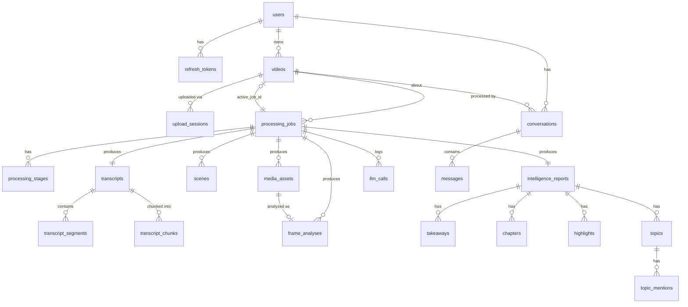

# Database Schema (Initial Proposal)

Status: **Phase 2 tables implemented** (see §7 for how the implementation differs from this proposal). PostgreSQL 16 with the `pgvector`, `citext` and `pgcrypto` extensions.

The schema will be implemented as Drizzle definitions with generated SQL migrations (ADR-011). The DDL below is the reviewable intent. Exact column types may change slightly during implementation, and tables arrive in the phase that needs them (see the last section).

---

## 1. Conventions

- **Primary keys:** `uuid` generated in the app as **UUIDv7** (time-ordered, so B-tree indexes stay compact and no extra column is needed for ordering). High-volume child rows (`transcript_segments`) use `bigint` identity keys.
- **Timestamps:** `timestamptz`, with `created_at` and `updated_at` everywhere (`updated_at` maintained by the app).
- **Media time:** integer **milliseconds** (`start_ms`, `end_ms`). Never floats, never strings.
- **Enums:** Postgres `enum` types for stable state sets. Values are added only through migrations.
- **Soft delete:** only for `videos` (`deleted_at`). Artifacts cascade through FKs when a video is hard-purged.
- **Ownership:** every user-facing query goes through `videos.owner_id`. Artifact tables reach the owner through `video_id` or `job_id`.
- **Write ownership:** **N** = written by NestJS, **P** = written by Python (ADR-003), enforced with separate DB roles.
- **Artifact versioning:** AI artifacts belong to a `processing_job`. `videos.active_job_id` points to the job whose results are shown. Reprocessing never destroys the current results.

---

## 2. Entity-relationship overview



---

## 3. DDL

### 3.1 Extensions and enums

```sql
CREATE EXTENSION IF NOT EXISTS citext;
CREATE EXTENSION IF NOT EXISTS vector;
CREATE EXTENSION IF NOT EXISTS pgcrypto;

CREATE TYPE user_role          AS ENUM ('user', 'admin');
CREATE TYPE video_source_type  AS ENUM ('upload', 'youtube');
CREATE TYPE video_status       AS ENUM ('uploading', 'uploaded', 'processing', 'ready', 'failed');
CREATE TYPE upload_status      AS ENUM ('in_progress', 'completed', 'aborted', 'expired');
CREATE TYPE job_status         AS ENUM ('queued', 'running', 'succeeded', 'failed', 'cancelled');
CREATE TYPE stage_name         AS ENUM ('probe', 'extract_media', 'detect_scenes', 'transcribe',
                                        'analyze_frames', 'analyze_transcript', 'embed', 'finalize');
CREATE TYPE stage_status       AS ENUM ('pending', 'running', 'succeeded', 'failed', 'skipped');
CREATE TYPE media_asset_kind   AS ENUM ('audio', 'keyframe', 'thumbnail', 'proxy_video');
CREATE TYPE visual_type        AS ENUM ('slide', 'code', 'diagram', 'chart', 'demo', 'person', 'other');
CREATE TYPE grounding_type     AS ENUM ('stated', 'interpretation');
CREATE TYPE highlight_kind     AS ENUM ('explanation', 'insight', 'recommendation', 'demonstration', 'qa');
CREATE TYPE message_role       AS ENUM ('user', 'assistant');
```

### 3.2 Identity (N)

```sql
CREATE TABLE users (
  id             uuid PRIMARY KEY,
  email          citext NOT NULL UNIQUE,
  password_hash  text   NOT NULL,                -- argon2id encoded string
  display_name   text,
  role           user_role NOT NULL DEFAULT 'user',
  created_at     timestamptz NOT NULL DEFAULT now(),
  updated_at     timestamptz NOT NULL DEFAULT now()
);

CREATE TABLE refresh_tokens (
  id           uuid PRIMARY KEY,
  user_id      uuid NOT NULL REFERENCES users(id) ON DELETE CASCADE,
  family_id    uuid NOT NULL,                    -- rotation chain; reuse ⇒ revoke family
  token_hash   bytea NOT NULL UNIQUE,            -- sha256 of the opaque token
  expires_at   timestamptz NOT NULL,
  revoked_at   timestamptz,
  replaced_by  uuid REFERENCES refresh_tokens(id),
  user_agent   text,
  ip           inet,
  created_at   timestamptz NOT NULL DEFAULT now()
);
CREATE INDEX refresh_tokens_user_idx   ON refresh_tokens (user_id);
CREATE INDEX refresh_tokens_family_idx ON refresh_tokens (family_id);
```

### 3.3 Videos and uploads (N, with Python updating media metadata columns)

```sql
CREATE TABLE videos (
  id                 uuid PRIMARY KEY,
  owner_id           uuid NOT NULL REFERENCES users(id) ON DELETE CASCADE,
  title              text NOT NULL,
  source_type        video_source_type NOT NULL,
  source_url         text,                          -- youtube URL when applicable
  status             video_status NOT NULL DEFAULT 'uploading',
  original_filename  text,
  storage_key        text,                          -- s3 key of the original
  mime_type          text,
  size_bytes         bigint CHECK (size_bytes >= 0),
  checksum_sha256    bytea,
  -- populated by `probe` (P)
  duration_ms        integer CHECK (duration_ms >= 0),
  width              integer,
  height             integer,
  fps                numeric(6,3),
  video_codec        text,
  audio_codec        text,
  language           text,                          -- BCP-47, detected by ASR
  probe_metadata     jsonb,                         -- raw ffprobe subset for debugging
  active_job_id      uuid,                          -- FK added after processing_jobs
  created_at         timestamptz NOT NULL DEFAULT now(),
  updated_at         timestamptz NOT NULL DEFAULT now(),
  deleted_at         timestamptz
);
-- Library listing (cursor pagination by id = UUIDv7 ≈ created order)
CREATE INDEX videos_owner_list_idx ON videos (owner_id, id DESC) WHERE deleted_at IS NULL;
CREATE INDEX videos_status_idx     ON videos (status) WHERE deleted_at IS NULL AND status IN ('processing','uploading');

CREATE TABLE upload_sessions (
  id              uuid PRIMARY KEY,
  video_id        uuid NOT NULL REFERENCES videos(id) ON DELETE CASCADE,
  s3_upload_id    text NOT NULL,
  storage_key     text NOT NULL,
  part_size_bytes integer NOT NULL,
  total_parts     integer NOT NULL CHECK (total_parts BETWEEN 1 AND 10000),
  status          upload_status NOT NULL DEFAULT 'in_progress',
  expires_at      timestamptz NOT NULL,
  completed_at    timestamptz,
  created_at      timestamptz NOT NULL DEFAULT now()
);
CREATE UNIQUE INDEX upload_sessions_one_active_idx ON upload_sessions (video_id) WHERE status = 'in_progress';
CREATE INDEX upload_sessions_expiry_idx ON upload_sessions (expires_at) WHERE status = 'in_progress';
```

### 3.4 Processing (jobs: N creates and Python transitions; stages: P)

```sql
CREATE TABLE processing_jobs (
  id                   uuid PRIMARY KEY,
  video_id             uuid NOT NULL REFERENCES videos(id) ON DELETE CASCADE,
  requested_by         uuid REFERENCES users(id) ON DELETE SET NULL,
  idempotency_key      text NOT NULL,
  pipeline_version     text NOT NULL,                -- e.g. '2026.11.1'; recorded config snapshot below
  config               jsonb NOT NULL,               -- models, prompt versions, budgets used
  status               job_status NOT NULL DEFAULT 'queued',
  current_stage        stage_name,
  cancel_requested_at  timestamptz,
  error_code           text,                         -- typed, e.g. 'MEDIA_NO_AUDIO'
  error_message        text,
  queued_at            timestamptz NOT NULL DEFAULT now(),
  started_at           timestamptz,
  finished_at          timestamptz,
  created_at           timestamptz NOT NULL DEFAULT now(),
  updated_at           timestamptz NOT NULL DEFAULT now(),
  UNIQUE (video_id, idempotency_key)
);
-- At most one active job per video
CREATE UNIQUE INDEX processing_jobs_one_active_idx
  ON processing_jobs (video_id) WHERE status IN ('queued', 'running');
CREATE INDEX processing_jobs_video_idx  ON processing_jobs (video_id, created_at DESC);
CREATE INDEX processing_jobs_active_idx ON processing_jobs (status) WHERE status IN ('queued','running');

ALTER TABLE videos
  ADD CONSTRAINT videos_active_job_fk FOREIGN KEY (active_job_id)
  REFERENCES processing_jobs(id) ON DELETE SET NULL;

CREATE TABLE processing_stages (
  id            uuid PRIMARY KEY,
  job_id        uuid NOT NULL REFERENCES processing_jobs(id) ON DELETE CASCADE,
  stage         stage_name NOT NULL,
  status        stage_status NOT NULL DEFAULT 'pending',
  attempt       smallint NOT NULL DEFAULT 0,
  progress      smallint NOT NULL DEFAULT 0 CHECK (progress BETWEEN 0 AND 100),
  heartbeat_at  timestamptz,                         -- reconciler detects stuck stages
  started_at    timestamptz,
  finished_at   timestamptz,
  duration_ms   integer,
  error_code    text,
  error_message text,
  metrics       jsonb,                               -- rtf, tokens, frames analyzed, peak_rss...
  output_prefix text,                                -- s3 prefix of stage artifacts
  UNIQUE (job_id, stage)
);
CREATE INDEX processing_stages_running_idx ON processing_stages (heartbeat_at) WHERE status = 'running';
```

### 3.5 Media artifacts (P)

```sql
CREATE TABLE media_assets (
  id            uuid PRIMARY KEY,
  job_id        uuid NOT NULL REFERENCES processing_jobs(id) ON DELETE CASCADE,
  video_id      uuid NOT NULL REFERENCES videos(id) ON DELETE CASCADE,
  kind          media_asset_kind NOT NULL,
  storage_key   text NOT NULL,
  timestamp_ms  integer,                             -- keyframes/thumbnails
  width         integer,
  height        integer,
  phash         bigint,                              -- 64-bit perceptual hash for dedup
  size_bytes    bigint,
  created_at    timestamptz NOT NULL DEFAULT now(),
  UNIQUE (job_id, storage_key)
);
CREATE INDEX media_assets_job_kind_idx ON media_assets (job_id, kind, timestamp_ms);

CREATE TABLE scenes (
  id                uuid PRIMARY KEY,
  job_id            uuid NOT NULL REFERENCES processing_jobs(id) ON DELETE CASCADE,
  idx               integer NOT NULL,
  start_ms          integer NOT NULL,
  end_ms            integer NOT NULL CHECK (end_ms > start_ms),
  keyframe_asset_id uuid REFERENCES media_assets(id) ON DELETE SET NULL,
  UNIQUE (job_id, idx)
);
```

### 3.6 Transcripts and retrieval (P)

```sql
CREATE TABLE transcripts (
  id             uuid PRIMARY KEY,
  job_id         uuid NOT NULL UNIQUE REFERENCES processing_jobs(id) ON DELETE CASCADE,
  video_id       uuid NOT NULL REFERENCES videos(id) ON DELETE CASCADE,
  language       text NOT NULL,
  provider       text NOT NULL,                      -- 'mlx-whisper' | 'faster-whisper' | 'youtube-captions'
  model          text NOT NULL,                      -- 'whisper-large-v3-turbo'
  segment_count  integer NOT NULL,
  word_count     integer NOT NULL,
  speech_ms      integer,                            -- after VAD
  created_at     timestamptz NOT NULL DEFAULT now()
);
CREATE INDEX transcripts_video_idx ON transcripts (video_id);

CREATE TABLE transcript_segments (
  id             bigint GENERATED ALWAYS AS IDENTITY PRIMARY KEY,
  transcript_id  uuid NOT NULL REFERENCES transcripts(id) ON DELETE CASCADE,
  idx            integer NOT NULL,                   -- the citation ID "S{idx}"
  start_ms       integer NOT NULL,
  end_ms         integer NOT NULL CHECK (end_ms >= start_ms),
  text           text NOT NULL,
  speaker        text,                               -- reserved for diarization
  avg_logprob    real,
  no_speech_prob real,
  words          jsonb,                              -- [{w, s, e, p}] word-level timings
  tsv            tsvector GENERATED ALWAYS AS (to_tsvector('simple', text)) STORED,
  UNIQUE (transcript_id, idx)
);
-- Time-range reads (transcript paging, citation resolution)
CREATE INDEX transcript_segments_time_idx ON transcript_segments (transcript_id, start_ms);
CREATE INDEX transcript_segments_tsv_idx  ON transcript_segments USING gin (tsv);

CREATE TABLE transcript_chunks (                    -- retrieval chunks (~250–400 tokens)
  id                 uuid PRIMARY KEY,
  transcript_id      uuid NOT NULL REFERENCES transcripts(id) ON DELETE CASCADE,
  video_id           uuid NOT NULL REFERENCES videos(id) ON DELETE CASCADE,  -- denormalized for filtered ANN
  idx                integer NOT NULL,
  first_segment_idx  integer NOT NULL,
  last_segment_idx   integer NOT NULL,
  start_ms           integer NOT NULL,
  end_ms             integer NOT NULL,
  text               text NOT NULL,                  -- may include merged [VISUAL] descriptions
  token_count        integer NOT NULL,
  embedding_model    text NOT NULL,
  embedding          vector(1024) NOT NULL,
  tsv                tsvector GENERATED ALWAYS AS (to_tsvector('simple', text)) STORED,
  UNIQUE (transcript_id, idx)
);
CREATE INDEX transcript_chunks_embedding_idx ON transcript_chunks
  USING hnsw (embedding vector_cosine_ops) WITH (m = 16, ef_construction = 64);
CREATE INDEX transcript_chunks_tsv_idx   ON transcript_chunks USING gin (tsv);
CREATE INDEX transcript_chunks_video_idx ON transcript_chunks (video_id);

CREATE TABLE frame_analyses (
  id            uuid PRIMARY KEY,
  job_id        uuid NOT NULL REFERENCES processing_jobs(id) ON DELETE CASCADE,
  asset_id      uuid NOT NULL REFERENCES media_assets(id) ON DELETE CASCADE,
  timestamp_ms  integer NOT NULL,
  visual_type   visual_type NOT NULL,
  description   text NOT NULL,
  ocr_text      text,
  selection_score real,                              -- why this frame was chosen
  model         text NOT NULL,
  created_at    timestamptz NOT NULL DEFAULT now(),
  UNIQUE (job_id, asset_id)
);
CREATE INDEX frame_analyses_time_idx ON frame_analyses (job_id, timestamp_ms);
```

> **Text search config:** `simple` is language-agnostic (no stemming), which is a safe default for mixed English/Spanish content. Per-language configs (`english`, `spanish`) driven by `transcripts.language` are a possible later improvement, decided by retrieval evaluations.

> **Embedding dimension:** fixed at 1024 for Qwen3-Embedding-0.6B. Changing models means a migration plus a re-embed job. `embedding_model` records what produced each row.

### 3.7 Intelligence report (P)

```sql
CREATE TABLE intelligence_reports (
  id                 uuid PRIMARY KEY,
  job_id             uuid NOT NULL UNIQUE REFERENCES processing_jobs(id) ON DELETE CASCADE,
  video_id           uuid NOT NULL REFERENCES videos(id) ON DELETE CASCADE,
  executive_summary  text NOT NULL,
  summary_points     jsonb NOT NULL,                 -- [{text, segment_ids[], grounding}]
  models             jsonb NOT NULL,                 -- {map:'qwen3:4b', reduce:'qwen3:8b', ...}
  prompt_version     text NOT NULL,
  quality            jsonb,                          -- citation validity, dropped-items rate, etc.
  created_at         timestamptz NOT NULL DEFAULT now()
);
CREATE INDEX intelligence_reports_video_idx ON intelligence_reports (video_id);

-- Shared shape for grounded items: primary span + evidence segment ranges.
CREATE TABLE takeaways (
  id              uuid PRIMARY KEY,
  report_id       uuid NOT NULL REFERENCES intelligence_reports(id) ON DELETE CASCADE,
  rank            smallint NOT NULL,
  title           text NOT NULL,
  description     text NOT NULL,
  why_it_matters  text NOT NULL,
  start_ms        integer NOT NULL,
  end_ms          integer,
  evidence        jsonb NOT NULL,                    -- [{from_idx, to_idx}] segment ranges
  grounding       grounding_type NOT NULL,
  confidence      real CHECK (confidence BETWEEN 0 AND 1),
  UNIQUE (report_id, rank)
);

CREATE TABLE chapters (
  id           uuid PRIMARY KEY,
  report_id    uuid NOT NULL REFERENCES intelligence_reports(id) ON DELETE CASCADE,
  idx          smallint NOT NULL,
  title        text NOT NULL,
  description  text NOT NULL,
  start_ms     integer NOT NULL,
  end_ms       integer NOT NULL CHECK (end_ms > start_ms),
  UNIQUE (report_id, idx)
);

CREATE TABLE highlights (
  id           uuid PRIMARY KEY,
  report_id    uuid NOT NULL REFERENCES intelligence_reports(id) ON DELETE CASCADE,
  kind         highlight_kind NOT NULL,
  title        text NOT NULL,
  description  text NOT NULL,
  quote        text,                                 -- verbatim transcript excerpt
  start_ms     integer NOT NULL,
  end_ms       integer,
  evidence     jsonb NOT NULL,
  grounding    grounding_type NOT NULL,
  confidence   real CHECK (confidence BETWEEN 0 AND 1)
);
CREATE INDEX highlights_report_idx ON highlights (report_id, kind, start_ms);

CREATE TABLE topics (
  id           uuid PRIMARY KEY,
  report_id    uuid NOT NULL REFERENCES intelligence_reports(id) ON DELETE CASCADE,
  name         text NOT NULL,
  slug         text NOT NULL,
  description  text,
  weight       real NOT NULL,                        -- share of transcript time
  UNIQUE (report_id, slug)
);

CREATE TABLE topic_mentions (
  id                 uuid PRIMARY KEY,
  topic_id           uuid NOT NULL REFERENCES topics(id) ON DELETE CASCADE,
  start_ms           integer NOT NULL,
  end_ms             integer NOT NULL,
  first_segment_idx  integer NOT NULL,
  last_segment_idx   integer NOT NULL
);
CREATE INDEX topic_mentions_topic_idx ON topic_mentions (topic_id, start_ms);
```

**Why `evidence` is `jsonb` rather than a separate citations table:** evidence is always read and written together with its parent item, is never queried on its own, and a polymorphic `citations(item_type, item_id)` table would lose FK integrity. The primary span (`start_ms`) is a real column because the UI sorts and navigates by it.

### 3.8 Q&A (N writes conversations and user messages; Python returns assistant content that NestJS persists)

```sql
CREATE TABLE conversations (
  id          uuid PRIMARY KEY,
  user_id     uuid NOT NULL REFERENCES users(id) ON DELETE CASCADE,
  video_id    uuid NOT NULL REFERENCES videos(id) ON DELETE CASCADE,
  title       text,
  created_at  timestamptz NOT NULL DEFAULT now(),
  updated_at  timestamptz NOT NULL DEFAULT now()
);
CREATE INDEX conversations_user_video_idx ON conversations (user_id, video_id, updated_at DESC);

CREATE TABLE messages (
  id               uuid PRIMARY KEY,
  conversation_id  uuid NOT NULL REFERENCES conversations(id) ON DELETE CASCADE,
  role             message_role NOT NULL,
  content          text NOT NULL,
  citations        jsonb,         -- [{segment_idx, start_ms, end_ms, chunk_id}]
  grounding        jsonb,         -- {stated_spans:[...], inferred_spans:[...], unsupported: bool}
  job_id           uuid REFERENCES processing_jobs(id) ON DELETE SET NULL,  -- which artifacts answered it
  model            text,
  latency_ms       integer,
  tokens_in        integer,
  tokens_out       integer,
  created_at       timestamptz NOT NULL DEFAULT now()
);
CREATE INDEX messages_conversation_idx ON messages (conversation_id, created_at);
```

### 3.9 AI observability (P)

```sql
CREATE TABLE llm_calls (
  id                 uuid PRIMARY KEY,
  job_id             uuid REFERENCES processing_jobs(id) ON DELETE CASCADE,
  stage              stage_name,
  operation          text NOT NULL,                  -- 'map_chunk', 'reduce_takeaways', 'qa_generate'...
  model              text NOT NULL,
  prompt_version     text NOT NULL,
  cache_key          text,                           -- sha256(input, prompt_version, model)
  cache_hit          boolean NOT NULL DEFAULT false,
  input_tokens       integer,
  output_tokens      integer,
  latency_ms         integer,
  validation_status  text NOT NULL,                  -- 'valid' | 'repaired' | 'failed'
  repair_attempts    smallint NOT NULL DEFAULT 0,
  error              text,
  trace_id           text,
  created_at         timestamptz NOT NULL DEFAULT now()
);
CREATE INDEX llm_calls_job_idx   ON llm_calls (job_id, stage);
CREATE INDEX llm_calls_cache_idx ON llm_calls (cache_key) WHERE validation_status <> 'failed';
```

The cached LLM _outputs_ live in S3 under `llm-cache/{cache_key}.json`, keeping large payloads out of Postgres. `llm_calls` holds metadata only.

---

## 4. Key query patterns → indexes

| Query                                                  | Index                                                                 |
| ------------------------------------------------------ | --------------------------------------------------------------------- |
| Library: user's videos, newest first, cursor           | `videos_owner_list_idx (owner_id, id DESC) WHERE deleted_at IS NULL`  |
| Status: the job and stages for a video                 | `processing_jobs_video_idx`, `UNIQUE(job_id, stage)`                  |
| Reconciler: stuck running stages                       | `processing_stages_running_idx (heartbeat_at) WHERE status='running'` |
| Enforce a single active job                            | `processing_jobs_one_active_idx` (partial unique)                     |
| Transcript page by time range                          | `transcript_segments_time_idx (transcript_id, start_ms)`              |
| Resolve citation `S412`                                | `UNIQUE(transcript_id, idx)`                                          |
| Dense retrieval within a video                         | `transcript_chunks_embedding_idx` (HNSW) + `video_id` filter          |
| Sparse retrieval                                       | `transcript_chunks_tsv_idx` (GIN)                                     |
| Report load (one round trip per table, by `report_id`) | `UNIQUE(report_id, …)` indexes                                        |

**Filtered ANN note:** HNSW with a selective `WHERE video_id = $1` can return fewer than k rows. Per-video corpora are small, so the plan is: (1) enable pgvector's iterative index scans (`hnsw.iterative_scan`, pgvector ≥ 0.8), or (2) skip the ANN index for single-video queries and do an exact scan with `ORDER BY embedding <=> $q` over the video's few hundred rows, which is fast. We'll pick by measurement in Phase 6.

---

## 5. Database roles (ADR-003)

```sql
CREATE ROLE vip_migrator LOGIN;   -- owns schema; used only by the migration job
CREATE ROLE vip_api      LOGIN;   -- NestJS
CREATE ROLE vip_ai       LOGIN;   -- Python worker + ai-api
-- vip_api: RW on users, refresh_tokens, videos, upload_sessions, processing_jobs, conversations, messages;
--          R on all artifact tables.
-- vip_ai:  RW on processing_stages, media_assets, scenes, transcripts, transcript_segments,
--          transcript_chunks, frame_analyses, intelligence_reports, takeaways, chapters,
--          highlights, topics, topic_mentions, llm_calls;
--          UPDATE(status, current_stage, started_at, finished_at, error_code, error_message, updated_at) on processing_jobs;
--          UPDATE(probe columns, language, status, active_job_id, updated_at) on videos;
--          R on videos, processing_jobs.
```

Grants are column-level where Python updates NestJS-owned rows, so the boundary is enforced by the database rather than by convention.

---

## 6. Introduction by phase

| Phase | Tables                                                                                                                     |
| ----- | -------------------------------------------------------------------------------------------------------------------------- |
| 1     | none (only the migration pipeline, extensions, and a smoke test)                                                           |
| 2     | `users`_, `refresh_tokens`_, `videos`, `upload_sessions`, `processing_jobs`, `processing_stages`, `media_assets`, `scenes` |
| 3     | `transcripts`, `transcript_segments`                                                                                       |
| 4     | `intelligence_reports`, `takeaways`, `chapters`, `highlights`, `topics`, `topic_mentions`, `llm_calls`                     |
| 5     | `conversations`, `messages` (UI)                                                                                           |
| 6     | `transcript_chunks`, `frame_analyses`                                                                                      |

\* Auth could arrive in Phase 2 or be deferred, with a seeded dev user, until Phase 5. See the roadmap's open questions.

---

## 7. Implementation notes (Phase 2)

The source of truth is now `apps/api/src/db/schema/index.ts` plus the SQL in `apps/api/drizzle/`. Differences from the proposal above:

| Change                                                                                                               | Reason                                                                                                                                |
| -------------------------------------------------------------------------------------------------------------------- | ------------------------------------------------------------------------------------------------------------------------------------- |
| `users.password_hash` is nullable                                                                                    | Auth is deferred to Phase 5. A null hash can never authenticate. `refresh_tokens` arrives with auth                                   |
| `processing_stages` gained `position`, `run` and `attempt`                                                           | `position` orders stages. `run` increments on manual retry and is part of the BullMQ job id. `attempt` counts deliveries within a run |
| `media_assets` gained `content_type`                                                                                 | Needed to serve artifacts with the right type                                                                                         |
| Group roles are `vip_api_rw` / `vip_ai_rw` (NOLOGIN), with login users `vip_api` / `vip_ai` attached by `db:migrate` | Passwords come from the environment, never from migrations. Grants are in `0002_ownership_roles.sql`                                  |
| `vip_api_rw` may also update a few `processing_stages` columns                                                       | The reconciler repairs stages whose worker died, and retry resets a failed stage                                                      |
| `videos_status_idx` not created yet                                                                                  | No query uses it yet; it gets added together with the first query that needs it                                                       |

### Phase 4 (intelligence report)

Migration `0004_intelligence_reports.sql` creates §3.7 and `llm_calls` (§3.9) as proposed, with these differences:

| Change                                                                                                           | Reason                                                                                                                                 |
| ---------------------------------------------------------------------------------------------------------------- | -------------------------------------------------------------------------------------------------------------------------------------- |
| `evidence` ranges are stored as `{from_idx, to_idx, start_ms, end_ms}`, resolved by the AI service at write time | The API serves citations without joining `transcript_segments`; a range only ever covers adjacent cited segments, never an uncited one |
| `summary_points` items carry `confidence` (the grounding check's semantic score)                                 | Same shape as takeaways and highlights, so the UI can treat every cited item alike                                                     |
| `llm_calls.cache_key` has no partial index                                                                       | Cache lookups go to S3 (`llm-cache/{key}.json`), not Postgres; `llm_calls` is metadata for debugging and cost accounting               |
| `vip_ai_rw` may only `SELECT, INSERT` on `llm_calls`                                                             | It's an append-only log                                                                                                                |

### Phase 5 (auth and Q&A)

Migrations `0005_auth.sql` (`refresh_tokens`) and `0006_conversations.sql` (`conversations`, `messages`, enum `message_role`), all owned by NestJS (`vip_api_rw`).

| Change                                            | Reason                                                                                                                                                                |
| ------------------------------------------------- | --------------------------------------------------------------------------------------------------------------------------------------------------------------------- |
| `refresh_tokens.replaced_at` added                | Distinguishes a concurrent refresh (two tabs, within 10 s: rejected, family kept) from reuse of a stolen token (later: whole family revoked)                          |
| `refresh_tokens.ip` is `text`, not `inet`         | Informational only (never queried); `req.ip` can be an IPv4-mapped IPv6 string                                                                                        |
| `messages.citations` is `[{idx, startMs, endMs}]` | Resolved and validated by the AI service at answer time, so the UI renders playable citations without a join                                                          |
| `messages.grounding` stores the answer's flags    | `{cited, invalidCitationsRemoved, inferred, notCovered, unsupported, retrievalHits}`: the UI warns on unsupported answers, and Phase 6 evaluations can aggregate them |
| `llm_calls` rows with `operation = 'qa_generate'` | Q&A calls are logged by the AI service against the job whose results answered them (`stage` is null)                                                                  |

### Phase 6 (retrieval and vision)

Migration `0007_retrieval_and_vision.sql` creates `transcript_chunks` and `frame_analyses` (§3.6) plus the `visual_type` enum, written by the AI service (`vip_ai_rw`) and readable by the API.

| Change                                                                                | Reason                                                                                                                                                |
| ------------------------------------------------------------------------------------- | ----------------------------------------------------------------------------------------------------------------------------------------------------- |
| `transcript_chunks.text` includes `[On screen at mm:ss: …]` notes                     | What was on screen is searchable by both the vector and the full-text index, and lands in the model's context next to the words spoken at that moment |
| HNSW (`m = 16, ef_construction = 64`, cosine) plus a GIN index on the generated `tsv` | The two halves of hybrid retrieval, both filtered to one transcript (ADR-014, ADR-026)                                                                |
| `frame_analyses.selection_score` stored                                               | Explains why each frame was sent to the vision model (deterministic selection signals)                                                                |
| `finalize` requires chunks whenever the transcript has speech                         | A published video must be answerable by hybrid search                                                                                                 |
